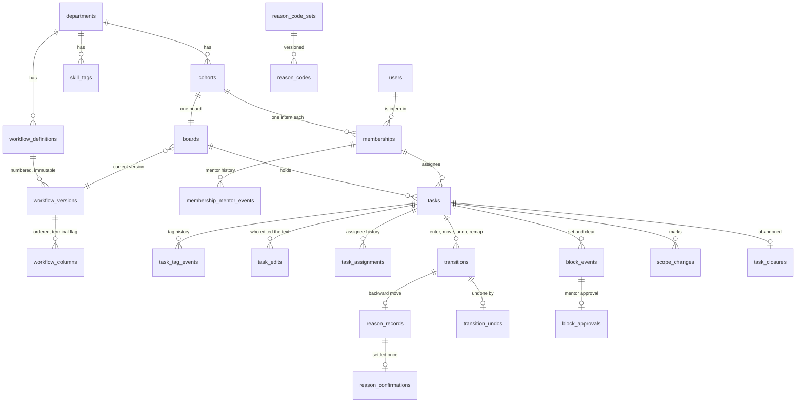

# Phase 2 schema

Seven migrations create 39 tables and 5 views on PostgreSQL. They implement implementation plan v4.0 Phase 2, ADR-07 and ADR-08, and the data inventory of the Data Handling and Integrity document. The `data_inventory` table holds the same inventory, and the tests fail if a table or a column pointing at a person is missing from it.

Status, 15 November 2026: applied, rolled back and reapplied on PostgreSQL 16.15, with the roles created by an admin that is not a superuser. The 133 tests in `db/test/schema_test.sh` pass under the real application, retention and backup roles. They include two concurrency cases and a dump-and-restore round trip. PostgreSQL 15 and 17 still need a run in CI (O62). The migrations do not enter the repository until the Phase 0 gate passes (O30).

## Layout

| File | Contents |
| --- | --- |
| `db/roles.sql` | Run once by the operator: three group roles, four login roles, the database and who may connect to it |
| `0001_foundation` | Role check, enum types, the database-clock, append-only and no-truncate trigger functions, helpers for later migrations |
| `0002_structure` | Installation, organisation, departments, users, cohorts, checkpoints, memberships, mentor history |
| `0003_workflow` | Workflow definitions, immutable versions and columns, column maps, boards, board-version history |
| `0004_reasons` | Reason code sets and codes, with the seven seeded defaults (DEC41) |
| `0005_tasks_and_ledger` | Skill tags, tasks, tag history, text-edit records, assignments, transitions, reasons, confirmations, undo links, blocks and approvals, scope changes, closures |
| `0006_operations` | Settings with limits and a change log written by the database, the audited events, audit log, erasure log, jobs, outbox, idempotency keys, data inventory |
| `0007_guards_and_grants` | Append-only, erasure-log and no-truncate triggers; grants for the runtime, retention and backup roles |

Each `.up.sql` has a `.down.sql` for development rollback. Each migration runs in one transaction.

## How the core tables relate



Every event row names the membership it is about (`subject_membership_id`, set by trigger to the assignee at that moment), the person who acted (`actor_user_id`, emptied if that person is erased) and the task version it produced (`task_version`).

## How the application writes a change

One transaction per change, in this order:

1. Take a shared lock on the board row (`SELECT ... FROM boards WHERE id = $1 FOR SHARE`). The task trigger takes it too; taking it first keeps the lock order the same as a board version switch.
2. `UPDATE tasks SET ..., version = $expected + 1 WHERE id = $2 AND version = $expected`. No row updated means a stale request: answer `409`.
3. Insert the event row or rows for what changed.
4. Commit. The deferred checks run here; a failure rolls everything back.

Retry the request on a deadlock (`40P01`) or a serialization failure (`40001`). Both can happen when a board version switch meets a card write.

The database cannot know the version a client expected, so step 2's `WHERE version = $expected` is the application's part of the `409` rule. Everything else in the table below is enforced by the database.

## What the database enforces

| Rule | How | Source |
| --- | --- | --- |
| Event times come from the database clock and never run backwards within a task | Triggers overwrite `occurred_at` with the time of the write | Plan 3.6 |
| Source column, time in previous column, backward flag | Computed by trigger from the previous transition and the column order | ADR-07 section 4, D8 |
| A backward move has a reason | Deferred check at commit | DEC10, plan 5.1 (`428`) |
| The reason list follows who made the move, not what the client claims | Trigger: the task's own intern gets the intern list, anyone else the mentor list | DEC10, DEC11 |
| A reason comes from the current code set | Trigger | DEC13 |
| Confirmation only for an intern's excusing reason, settled once, never after an undo, never by that intern; a rejection names a mentor-list reason | Trigger and unique key | DEC28, DEC53 |
| An intern is never their own mentor | Trigger | DEC28 |
| Undo only by the mover, inside the window, with the task unchanged | Trigger, window read from `settings` | DEC39, ADR-07 section 11 |
| Every task change raises the version by one; reordering does not | Trigger on `tasks` | ADR-07 sections 6 and 12 |
| Every task version has an event, and each thing that changed has the event that records it | Deferred check at commit, per change | ADR-07 section 12 |
| Tag changes and text edits leave history; an edit record names exactly the fields that changed | Event tables and the same deferred check | ADR-07 section 10 |
| A published workflow version or reason code set cannot gain, lose or change rows | Children accepted only in the transaction that created the parent; append-only triggers | ADR-07 section 2, DEC13 |
| A board only moves to a newer version, with its version event, and leaves no open card behind | Trigger and deferred check | DEC78 |
| Remap only through the column map, and a move only after the remap | Trigger | DEC78 |
| A card cannot be written against a version its board is leaving | Shared lock on the board row in the task trigger | DEC78 |
| A block needs a note; an intern's block is approved by someone else; a mentor's or administrator's block is approved when set | Check, trigger and deferred check | DEC69 |
| Scope changes and closures belong to mentors and administrators, not the task's own intern | Trigger | ADR-07 sections 8 and 9 |
| A closure needs a note and a non-terminal column, takes the database's time, and a closed task never changes | Checks and triggers | DEC81 |
| Each task keeps at least one tag, also when two people remove tags at once | Task row lock plus deferred check | D7 |
| Tags, tasks and boards stay inside one department | Triggers | Plan 5.1 |
| A cohort ends at most five years after it starts; a membership cannot end after its cohort | Check and triggers | DEC62, O64 |
| Ledger rows cannot be updated or deleted except by the retention role, which may only empty author links | Triggers plus column grants | Plan 4.4, DEC61 |
| Every delete of evidence or of an account writes its erasure-log entry; a delete with no declared run is refused; the log itself can never change | Triggers | DEC60 |
| No TRUNCATE on any table, by anyone | Statement trigger | Plan 4.6 |
| The application role cannot run DDL, create temporary tables, read the erasure log or take a backup | Owns nothing, no CREATE or TEMP, no grant | Plan 4.6 |
| The backup role reads everything and changes nothing | Grants | O66 |
| Every settings change is logged, without secret values; the application cannot write or skip the log | Trigger running with the owner's rights | DEC22, ADR-08 |
| Numeric settings stay inside limits; retention is 1 to 120 months; settings are never removed | Trigger and `setting_limits` | DEC22, DEC62, O64 |
| An audit entry uses a defined action; an IP address only on sign-in entries | Foreign key to `audit_actions`, check | DEC71 |
| Job payloads hold identifiers and codes, not names, emails or sentences | Check on the payload's shape | DEC64 |

## What stays with the application

- The expected version of a request (`WHERE version = $expected`), the `409` and `428` responses and idempotency.
- Roles: who is a mentor of whom at the time of an action, the department administrator's fallback after 5 working days, and everything in the permissions matrix (Phase 3). The database only knows who a task's own intern is.
- Local dates and working days. The database stores UTC and does no time-zone arithmetic; the server uses its embedded time-zone data.
- Refusing to write events for a membership that has ended.
- Refusing to start as a privileged database role.
- An edit or scope marker with no change behind it. The database guarantees the other direction: no change without its event.

## Known limits

- A database owner can disable triggers and alter rows. The schema protects against the application role and against mistakes, not against the customer's own database administrator (DEC72).
- "Children only in the parent's transaction" compares transaction start times to the microsecond. Two transactions would have to start in the same microsecond and one would have to commit before the other writes; this is not a practical risk, and the tables are append-only afterwards.
- Database-level connection rights are not part of a `pg_dump`. A database restored under a new name needs the three statements in `db/roles.sql` again.

## Run the tests

```sh
psql -v migrator_password=... -v app_password=... -v retention_password=... -v backup_password=... -f db/roles.sql   # as an admin with CREATEROLE, CREATEDB
for f in db/migrations/*.up.sql; do psql -U mile_migrator -d mile --single-transaction -v ON_ERROR_STOP=1 -f "$f"; done
PGADMIN=postgres db/test/schema_test.sh
```

In Phase 2 the Go migration runner replaces the loop (embedded migrations with an advisory lock), and these tests move into the Go integration suite, run against every supported PostgreSQL version.

## A later migration that adds a table

1. Create the table with a random UUID key; give an event table `subject_membership_id`, `actor_user_id` and `occurred_at`.
2. Call `add_no_truncate`. For an event table call `make_append_only`. For evidence or account data add the `log_erasure` trigger.
3. Grant what the runtime, retention and backup roles need, column by column for updates.
4. Add its `data_inventory` row: subject column, author columns, retention class, erasure step.

The tests fail if step 2 or step 4 is forgotten.

## Not in Phase 2

Added with their features (plan D6), already listed in the Data inventory tab: identity-provider links, role assignments, sessions, invitation and reset links (Phase 3); comments and in-app notifications (Phase 4); rubrics, assessments, frozen reviews, notebooks (Phase 6); retention requests, legal holds and backup records (Phase 7); Enterprise tables (Phase 9).

Names: roles, the database and the `mile.erasure_*` settings use the `mile` prefix.
